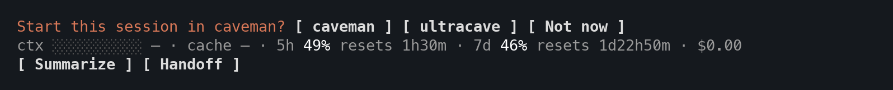
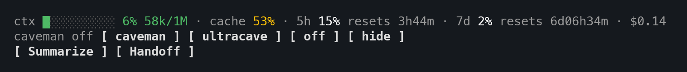

# Pulse-caveman

Turn caveman on with one press, and always see whether it is on, in which
mode, and for how long.


[Caveman](https://github.com/JuliusBrussee/caveman) is a family of Claude Code
skills that make Claude answer first and cut the filler, so it writes fewer
output tokens. Pulse-caveman does not ship them and never turns them on by
itself: you install the skills you want, and you choose when to use them.

## Install

In a Claude Code session:

```
/plugin marketplace add maciejploskonka/claude-plugins
/plugin install pulse-caveman@maciejploskonka
```

It works on its own, and inside the [Pulse](../pulse) bar when Pulse 0.3.0 or
later is installed. It needs the caveman skills, see below.

## Modes

Each mode is a skill of its own. Pulse-caveman offers the ones you have
installed:

| Mode | What Claude does |
| --- | --- |
| `caveman` | The voice: answer first, no ceremony or filler, every fact kept. |
| `ultracave` | Grammar stripped: fragments, one word when one word is enough. |
| `megacave` | Classical Chinese, technical terms kept as they are. |

## What you see

At the start of a conversation:



A mode button turns it on. `Not now`, or just writing your first message,
shrinks the question to one row (see the table below).

If you installed caveman as a plugin (`caveman@caveman`), caveman itself
starts every session in its default mode. Pulse-caveman reads that default
the way caveman does (`CAVEMAN_DEFAULT_MODE`, then `.caveman.json` or
`.caveman/config.json` in the project, then `~/.config/caveman/config.json`)
and starts as active instead of asking. With `"defaultMode": "manual"` you get
the question again.

| State | Row |
| --- | --- |
| Off | `caveman off [ modes ]` |
| Off, after `modes` | `caveman off [ caveman ] [ ultracave ] [ off ] [ hide ]` |
| Active | `ultracave (35m) [ Off ]` |
| Fading | `ultracave (35m) · fading [ Reload ] [ Off ]` |

The time counts from when you turned it on, across midnight: `(35m)`,
`(3h02m)`, `(2d03h02m)`. `[ hide ]` takes the
off row away for this conversation; turning caveman on brings it back.
`fading` means caveman may have
worn off: three wordy answers in a row (filler words or ceremony such as
"Sure!" and "Hope this helps"; `megacave` is not checked). `Reload` loads the
same mode again. A compaction (Summarize, `/compact` or automatic) does not
make it fade: Claude Code puts the skills you used back afterwards. `/clear`
starts a new conversation, so the question shows again. Pulse's
`Clear & continue` (after a handoff) carries the work on, so caveman carries
on too: the same mode, loaded again, with its time kept.

With Pulse 0.3.0 or later and its bar on, all of this moves into the Pulse bar:

```
ctx ██░░ 6% 60k/1M · cache 99% · … · $0.29 · ultracave (35m) [ Off ]
[ Summarize ] [ Handoff ]
```

`[ Off ]` ends the bar's first row; in a narrow terminal it moves to a row of
its own.

With caveman off, the row is short: `caveman off [ modes ]`. `modes` opens it
to a button per mode, `off` (folds it back) and `hide` (takes it away):



A resumed conversation (`claude --resume`) still holds caveman's
instructions, so Pulse-caveman remembers each conversation's mode and shows it
again on resume. A conversation it knows nothing about starts with the
question.

With an older Pulse, Pulse-caveman draws its own rows and adds a grey hint to
update Pulse.

## Commands

| Command | Does |
| --- | --- |
| `/pulse-caveman caveman`, `ultracave`, `megacave` | Turn that mode on |
| `/pulse-caveman off` | Turn it off |
| `/pulse-caveman reload` | Load the current mode again |
| `/pulse-caveman` | Say whether caveman is on |

What you type yourself is followed too: `/caveman`, `/ultracave`, `/megacave`,
`/caveman ultra`, `/caveman wenyan`, and "stop caveman" or "normal mode".
`/caveman status` answers with the mode Pulse-caveman tracks.

## Getting the caveman skills

Pulse-caveman works with caveman 4 or later, where each mode is a skill of its
own. Caveman is made by [Julius Brussee](https://github.com/JuliusBrussee/caveman)
(Apache-2.0). Install or update the skills one of these ways, then start a new
session:

```
npx skills add JuliusBrussee/caveman -g
```

or as a Claude Code plugin:

```
/plugin marketplace add JuliusBrussee/caveman
/plugin install caveman@caveman
```

With no caveman skill, or one from before caveman 4 (with `lite`, `full` and
`ultra` levels), Pulse-caveman shows one row with a link here and a `[ Skip ]`
button, and nothing else. Skip hides it until your caveman skills change.

## Known limits

- Claude Code reads plugins and skills when a session starts. Installing a
  skill or this plugin mid-session shows up in the next session.
- "stop caveman" is noticed in your own messages only, not in Claude's.
- Drift is a word count. It can miss, or flag a long quote. It only marks
  `fading`; it never acts.

## Changelog

- **0.1.0**: First release, for caveman 4 (`caveman`, `ultracave`, `megacave`).

## License

[MIT](../../LICENSE)
