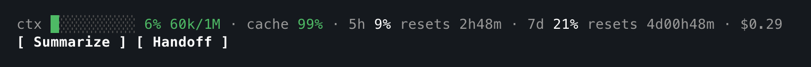
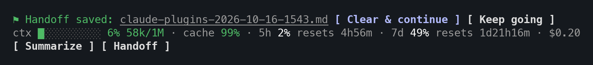
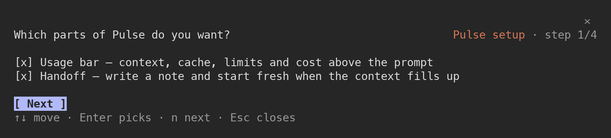
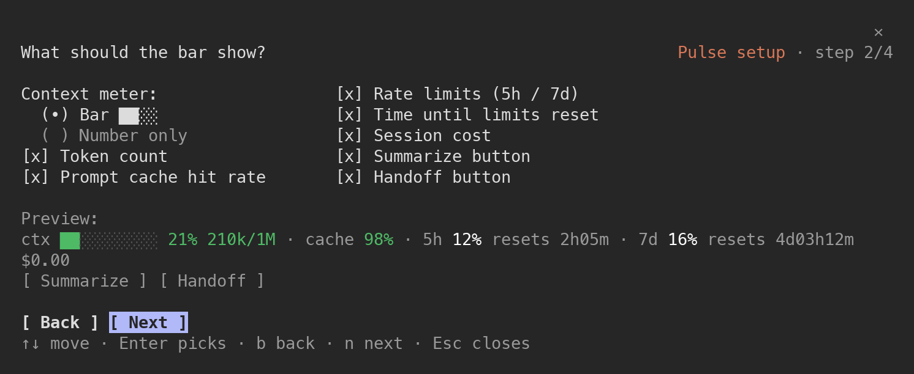
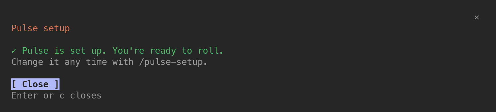

# Pulse

See how your Claude Code session is doing, and act on it in one click.



Pulse adds a bar above the prompt. It shows how full the context is, how well
the prompt cache works, how much of your rate limits you have used and when
they reset, and what the session has cost. Colours warn you before the context
runs out, and two buttons act on it: **Summarize** and **Handoff**.

## Install

In a Claude Code session:

```
/plugin marketplace add maciejploskonka/claude-plugins
/plugin install pulse@maciejploskonka
```

Pick `user` as the scope to have Pulse in every project. The setup wizard opens
on its own (see [Setup](#setup)).

## The bar

```
ctx ██░░░░░░░░ 21% 207k/1M · cache 98% · 5h 12% resets 2h05m · 7d 16% resets 4d03h12m · $1.23
[ Summarize ] [ Handoff ]
```

| Part | What it means |
| --- | --- |
| `ctx ██░░ 21% 207k/1M` | How full the context window is: meter, percent, tokens used of the window. |
| `cache 98%` | Prompt cache hit rate of Claude's last request. High is good: a cold cache bills the whole prompt again. |
| `5h 12% resets 2h05m` | The 5-hour rate limit: share used, time until it resets. |
| `7d 16% resets 4d03h12m` | The weekly rate limit, the same way. |
| `$1.23` | What this session has cost so far. |
| `[ Summarize ]` | Compacts the conversation, as `/compact` does. |
| `[ Handoff ]` | Writes a handoff note and starts fresh from it (see [Handoff](#handoff)). |

Every part can be turned off in the wizard. When the window is narrow, whole
parts move to the next row; the buttons always keep a row of their own. They
hide while Claude is working.

### Point a button at one part of the session

Type in the prompt box, do not press Enter, then press a button. Pulse uses
what you typed as the focus:

- `Summarize`: the summary keeps what you named, as `/compact <text>` does.
  For example: `keep the auth refactor, drop the CSS detour`.
- `Handoff`: the note covers only that part of the work. For example:
  `only the billing export bug`.

Pulse then empties the prompt box, so the text is not sent as a message too,
and says `Used your typed text as the focus.` With nothing typed, the buttons
work as before.

### Colours

The colours follow your Claude Code theme. The alarm level is yours to pick
(50, 60, 75 or 90%; 75% by default).

| | Green | Yellow | Red |
| --- | --- | --- | --- |
| Context | below the alarm | from the alarm | from the alarm + 15 |
| Cache | 80% and up | 50–79% | below 50% |
| Rate limits | white below 70% | 70–89% | 90% and up |

From the alarm level, `Handoff` turns into the highlighted button, and Pulse
shows one reminder: `Context 78% full — time for a handoff (press Handoff below).`

Labels, separators, reset times and the cost stay grey, so the numbers that
matter stand out.

## Handoff

A long session fills the context, and compaction loses detail. A handoff keeps
it: Claude writes down where the work stands, and a fresh conversation picks up
from that note.



1. Press `Handoff`. Claude writes a note: the goal,
   what is done, the current state (files, branches, commands), open problems,
   the exact next steps, and anything learned the hard way. To hand off only
   part of the session, type that part in the prompt box first (see
   [Point a button at one part of the session](#point-a-button-at-one-part-of-the-session)).
2. When the note is saved, the row offers `[ Clear & continue ]` and
   `[ Keep going ]`.
3. `Clear & continue` clears the conversation and asks the new one to read the
   note. It starts by saying in two lines where you are.

Notes are plain Markdown files, so you can read, edit or share them:

- `~/.claude/handoffs/<project>-<date>-<time>.md` (default, outside your
  projects), or
- `<project>/.claude/handoffs/...` if you pick the project folder. Then add
  `.claude/handoffs/` to `.gitignore`, so notes are not committed.

## Setup

On first launch Pulse opens a short wizard in a pane next to the session. It
needs only the arrow keys and Enter: every step starts on `Next`, so pressing
Enter takes the defaults, and Up reaches the answers.



1. **Features**: the usage bar, handoff.
2. **Bar**: meter style (bar or number), and which parts and buttons to show,
   with a live preview.
3. **Alarm**: when to warn you that the context is filling up.
4. **Handoff**: where the notes go.



`Finish` saves your answers and says so:



Change your answers any time with `/pulse-setup`. On a narrow terminal the
wizard waits, and a row above the prompt offers `[ Set up ]` and
`[ Use defaults ]`.

Wizard keys: `↑` `↓` move, `Enter` picks, `n` next, `b` back, `f` finish,
`Esc` closes without saving.

## Commands

| Command | Does |
| --- | --- |
| `/pulse-setup` | Change what Pulse shows and how |
| `/pulse-reset` | Restore the default settings |
| `/pulse-handoff [focus]` | Write a handoff note and offer to start fresh; text after the command is its focus. Only there when the bar shows no `Handoff` button (bar or button turned off) |

## FAQ

**What is the `[-]` at the right of the bar?** Claude Code draws it, not Pulse.
It folds the whole area above the prompt; Pulse cannot change it.

**There is an empty row under the buttons.** Claude Code keeps it for its own
short notices (the effort level, for one). It is not Pulse's.

**The cache shows `–`.** It fills in after Claude's first answer.

**Where are my settings?** In Claude Code's plugin storage, per user. They
survive restarts and updates. `/pulse-reset` brings back the defaults.

**How do I update?** `/plugin marketplace update maciejploskonka`, then
restart Claude Code if the new version does not show.

## Changelog

- **0.2.0**: Text typed in the prompt box, not sent, becomes the focus of the next `Summarize` or `Handoff`:
  what the summary keeps, or what the note is about. Nothing typed: the buttons work as before.
  `/pulse-handoff <focus>` takes its focus after the command.
- **0.1.2**: In a short setup pane, Up and Down move between choices instead of scrolling.
  Each setup step starts at its top item, so the step number shows; the bar step uses two columns.
  In a short pane the title, Back/Next and the key hints stay put and only the middle scrolls.
  The bar preview shows only in the tall setup pane docked beside the transcript, not in the short one above the prompt.
  `/pulse-handoff` is listed only when there is no `Handoff` button to press.
  The setup's last screen no longer lists what is turned on.
- **0.1.1**: Rate limits show placeholders until the first answer.
- **0.1.0**: First release.
